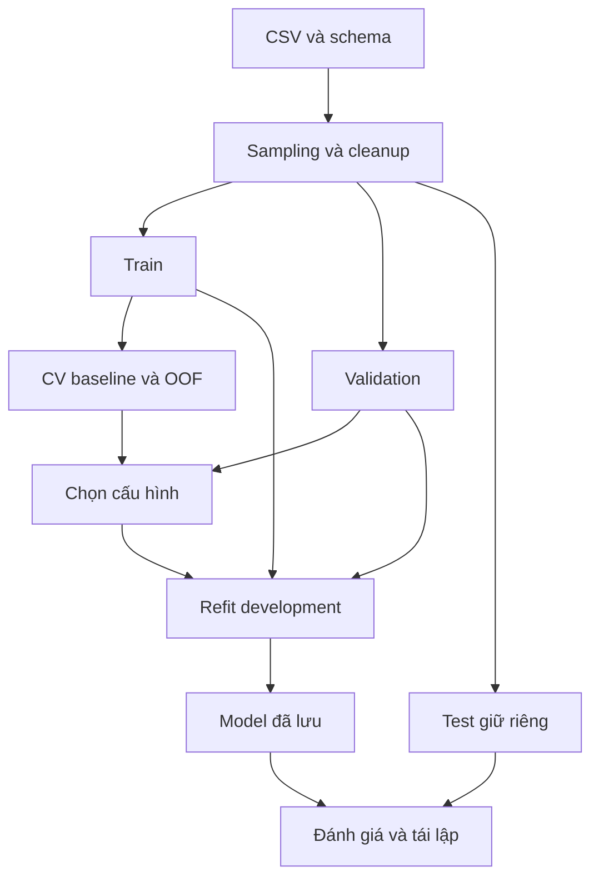

# Phát hiện tấn công mạng dựa trên Ensemble Stacking

Bản nội dung báo cáo cập nhật 10/11/2026. Các bảng thực nghiệm được cung cấp tại [CURRENT_RESULTS.md](CURRENT_RESULTS.md), đọc từ artifact thật. Bản này dùng để điền vào mẫu Word; phần triển khai chưa đo trên VM được ghi rõ, không điền số minh họa.

## Mở đầu

Đề tài nghiên cứu phát hiện tấn công mạng từ đặc trưng luồng, với trọng tâm là Ensemble Stacking hai tầng. Một thuật toán đơn có thể phù hợp với một số nhóm lưu lượng nhưng gặp khó khăn khi phân bố dữ liệu hoặc kiểu tấn công thay đổi. Kết hợp nhiều bộ học là một hướng cần kiểm chứng bằng thực nghiệm; không có bảo đảm Stacking sẽ luôn vượt các mô hình thành phần.

Mục tiêu là xây dựng pipeline tái lập, so sánh các baseline và Stacking trên CIC-IDS2017, InSDN và dữ liệu kết hợp; bổ sung Gaussian anomaly, tổng hợp theo host và đồ thị giao tiếp. Ba câu hỏi chính là: Stacking thay đổi Macro-F1/FPR/FNR thế nào so với baseline trên cùng test; việc bổ sung nguồn dữ liệu có lợi ở miền nào; chi phí và giới hạn triển khai là gì.

## Chương 1. Cơ sở lý thuyết

### 1.1. IDS và dữ liệu luồng

Hệ thống thuộc hướng NIDS: quan sát lưu lượng mạng và đưa ra dự đoán/cảnh báo. Cảnh báo không tự thực hiện chặn lưu lượng. Mô hình có giám sát học từ nhãn đã biết; không mặc nhiên là hệ thống phát hiện zero-day.

Flow hai chiều tổng hợp các gói tin liên quan theo endpoint, giao thức và thời gian. Bộ 12 feature hiện tại gồm cổng đích, thời lượng, số gói và số byte hai chiều, sáu loại cờ TCP. IP, Flow ID, timestamp và nhãn không được đưa vào vector Stacking. Các tên trong bảng CSV phải được ánh xạ theo schema, không theo vị trí cột. Đặc trưng cùng tên chưa chứng minh hai extractor tính giống nhau.

CIC-IDS2017 có traffic bình thường và nhiều loại tấn công trong môi trường thử nghiệm [1]. InSDN bổ sung miền SDN [2]. File local có lần lượt 2.830.743 và 205.167 hàng; nguồn tải, phạm vi subset và phiên bản cần được ghi cùng dữ liệu. Hai miền khác nhau về môi trường thu thập và hệ nhãn.

### 1.2. Ensemble Stacking và OOF

Các baseline là Decision Tree, Random Forest, XGBoost, LightGBM và Logistic Regression. Stacking dùng dự đoán xác suất từ các base learner làm đầu vào cho meta learner. Hai cấu hình được xét trước gồm RF/XGBoost/LightGBM và RF/XGBoost/LR; meta learner là LR.

Meta-feature được tạo bằng out-of-fold: chia train thành K fold, mỗi lần fit trên K−1 fold rồi dự đoán fold còn lại. Mỗi hàng vì thế nhận dự đoán từ base learner chưa fit trên hàng đó. Meta learner học trên các dự đoán này. Sau chọn cấu hình bằng validation, mô hình được refit trên development data. Đây là Stacking được học, khác với voting theo quy tắc cố định [3].

Imputer/scaler được đặt trong pipeline của từng base learner để không fit trước trên test hoặc toàn dữ liệu [4]. Tuning baseline trước khi tạo OOF không phải nested CV đầy đủ; held-out test là phép đánh giá bên ngoài, còn điểm CV phục vụ chọn tham số.

### 1.3. Gaussian anomaly

Một Gaussian với covariance đường chéo được fit chỉ trên BENIGN train. Đầu vào được biến đổi signed-log1p; ở host mode các bộ đếm phải không âm. Với đặc trưng x, điểm anomaly là negative log-density của Gaussian; điểm cao hơn ngưỡng là bất thường. Đây không phải xác suất bị tấn công.

Ngưỡng được chọn bằng quantile của điểm BENIGN validation với FPR mục tiêu 1%. Nhãn test không dùng để điều chỉnh ngưỡng. Một Gaussian đường chéo có giả định mạnh về phân bố và quan hệ giữa các feature, do đó cần đo cả FPR và tỷ lệ bỏ sót, không chỉ báo Accuracy [5].

### 1.4. Host và đồ thị giao tiếp

Mỗi host/window có số flow vào/ra, peer, cổng đích ra duy nhất, packet/byte gửi nhận và cờ trong các flow liên quan. Flow đóng góp tại cửa sổ hoàn tất để không dùng gói tin tương lai cho cửa sổ trước. Nhãn ATTACK của host/window bao gồm cả nạn nhân; không đồng nghĩa host bị nhiễm.

Graph biểu diễn host là node và giao tiếp là cạnh. Fan-in/fan-out và kết nối tương hỗ theo cửa sổ tạo danh sách ứng viên để điều tra. Server hợp pháp, scan và botnet đều có thể tạo hub; xác nhận botnet/C2 cần ground truth độc lập. SVG chỉ là tổng quan có giới hạn node, GraphML/CSV giữ dữ liệu đầy đủ.

Beaconing offline nhóm flow chưa lấy mẫu theo IP nguồn, IP đích, cổng đích và protocol. Tính interval giữa các thời điểm bắt đầu khác nhau, trung bình, sample SD và hệ số biến thiên CV=SD/mean. Ngưỡng số quan sát, khoảng thời gian và CV chọn ứng viên định kỳ; không tự suy ra C2 vì polling hợp pháp và timeout cũng có thể tạo chu kỳ. Phân tích timing/size có cơ sở tham khảo ở RITA [6]; module này chỉ hiện thực heuristic CV đơn giản.

### 1.5. Metrics

Quy ước ATTACK là lớp dương. Precision = TP/(TP+FP), Recall = TP/(TP+FN), F1 = 2PR/(P+R), FPR = FP/(FP+TN), FNR = FN/(TP+FN). Macro-F1 lấy trung bình F1 theo lớp và dùng làm metric chọn cấu hình. Cần báo support, nhãn bị loại và confusion matrix. Nếu test không có attack thì FNR không xác định, không báo là 0.

Thời gian dự đoán batch khác với thời gian từ gói đầu đến cảnh báo: flow có thể cần chờ idle/max-age, queue và xử lý. Các số đo live phải được thu trên phiên lab riêng.

## Chương 2. Phân tích và thiết kế

### 2.1. Phát biểu bài toán

Mỗi flow được biểu diễn bằng 12 đặc trưng số để dự đoán BENIGN/ATTACK. M1 dùng CIC, M2 dùng InSDN, M3 dùng development data của hai nguồn. Mỗi cấu hình chạy năm baseline và Stacking. Thí nghiệm đa lớp riêng giữ tên các loại tấn công sau chuẩn hóa Normal thành BENIGN.

### 2.2. Pipeline và ranh giới đánh giá

Đọc CSV theo chunk, chuẩn hóa numeric, xử lý nhãn rỗng và feature thiếu toàn bộ. Sampling theo lớp giới hạn RAM. Vector trùng và mâu thuẫn nhãn trong mẫu được loại; ở M1/M2/M3 còn khử trùng giữa nguồn trước chia tập. Mỗi nguồn chia stratified random 60/20/20. M3 nối hai train và hai validation, sử dụng đúng Test CIC/Test InSDN của M1/M2 và test gộp từ hai test đó.

Test gộp tính metrics trên toàn bộ dự đoán nối lại, không lấy trung bình F1 từng nguồn. M3 chỉ fit một lần. Protocol v2 có 30 hàng kết quả mỗi seed; v1 cũ có 24 hàng và không tổng hợp lẫn v2.

### 2.3. Tổ chức chương trình

| Module | Trách nhiệm |
|---|---|
| `dataset.py`, `features.py`, `eda.py` | Hợp đồng schema, lấy mẫu/cleanup và EDA |
| `train.py`, `three_models.py`, `train_all.py` | Baseline, OOF, chọn cấu hình, refit, test chung |
| `summarize.py`, `check_model.py` | Tổng hợp seed và kiểm tra model đã lưu |
| `evaluate_model.py`, `size_ablation.py` | Đánh giá bằng nhãn thật và so sánh khi giữ cùng cỡ mẫu |
| `flows.py`, `extract.py`, `detect.py` | Flow table, PCAP, capture và log cảnh báo |
| `host_features.py`, `gaussian.py`, `botnet_graph.py` | Tổng hợp host, anomaly và phân tích graph |
| `beaconing.py` | Ứng viên kết nối định kỳ từ metadata flow chưa lấy mẫu |
| `evaluate_lab.py`, `feature_parity.py` | Đối chiếu ground truth và đặc trưng hai extractor |

Lưu trữ dùng CSV, JSON, joblib, GraphML và SVG; không cần CSDL giao dịch cho pipeline hiện tại. Không ghi đè các lượt hoàn chỉnh. Chỉ load joblib từ nguồn tin cậy.

## Chương 3. Triển khai và thực nghiệm

### 3.1. Môi trường và giao thức

Thực nghiệm Windows dùng Python và các phiên bản package ghi trong `experiments/completion-20261110/environment.json`. Mỗi model Stacking có requirements-deploy riêng. Nhị phân dùng cap 5.000, 120 cây, 3 folds, seed 7/21/42, có tuning. Đa lớp seed 42 dùng cap 2.000, 60 cây. Các giới hạn cap áp dụng trước khử trùng và có thể thay đổi phân bố test.

### 3.2. Kết quả và phân tích

Các bảng đầy đủ nằm trong [CURRENT_RESULTS.md](CURRENT_RESULTS.md), gồm mean/SD Stacking so baseline, đa lớp, Gaussian và thống kê graph. Đường dẫn artifacts và lệnh chạy nằm trong [THREE_MODELS.md](THREE_MODELS.md) và [EXTENSIONS.md](EXTENSIONS.md).

Stacking chưa vượt baseline nhất quán. Đã bổ sung ablation giữ cùng số hàng từng lớp trong train/validation: nguồn CIC, nguồn InSDN và hỗn hợp 50/50. Ba seed tạo 162 hàng kết quả. Mixed có Macro-F1 test gộp 99,422 ± 0,161%, so với 84,598 ± 1,354% và 69,514 ± 2,982% của hai nguồn đơn matched. Tuy vậy, Mixed thấp hơn model cùng miền trên hai test riêng. Kết quả mô tả lợi ích bao phủ hai miền đã thấy ở cùng quy mô; đây là phân tích trên test đã xem trước, không xác nhận miền mới hay ý nghĩa thống kê.

Đánh giá lại M3 seed 42 từ artifact trên toàn test bằng nhãn thật, không fit lại, cho Accuracy CIC 99,309% (13 lỗi/1882 flow) và InSDN 99,933% (1 lỗi/1485). Kết quả khớp metrics gốc; khác với Prediction match chỉ kiểm tra dự đoán đã lưu.

Gaussian flow có FPR thấp nhưng bỏ sót nhiều attack; trên Test InSDN hiện chưa phát hiện được ATTACK. Đây là hạn chế của mô hình/cấu hình đang đo, không được bỏ qua khi báo cáo. Host test theo thời gian chỉ có BENIGN nên FNR không xác định. Đồ thị InSDN là bằng chứng cấu trúc giao tiếp, chưa có nhãn infected/C2 để đo botnet Recall.

Beaconing phân tích 131744 flow TCP/UDP, tạo 37443 nhóm và 3 ứng viên chu kỳ 120 giây. Cả 23 flow tương ứng đều mang nhãn Normal trong CSV gốc. Kết quả minh họa giới hạn của việc dùng tính định kỳ làm dấu hiệu C2; không coi các IP ứng viên là botnet.

### 3.3. Kiểm thử và triển khai lab

48 test đã qua, bao gồm schema, split, OOF/refit/export, test gộp, Gaussian, host, graph, parity, PCAP tổng hợp, kiểm tra nhãn lab, bảo vệ log, đánh giá nhãn thật, beaconing, matched ablation và meta-search OOF. Các classifier nhỏ và capture tổng hợp trong test chỉ xác minh logic, không dùng làm số liệu benchmark.

Lần thử capture thật trên Windows được giới hạn vào loopback/cổng HTTP demo riêng. Npcap từ chối vì Admin-only Mode và phiên không có quyền Administrator, nên chưa có PCAP hoặc metrics live để công bố. Trạng thái blocked được ghi riêng, không đưa vào các bảng kết quả.

Sau lần thử của agent, người dùng mở PowerShell Administrator và đã capture HTTP localhost thành công, có log BENIGN. Đây là bằng chứng live Windows hoạt động, chưa thay thế đánh giá attack lab hoặc Linux. Phạm vi chính theo STACKING_SCOPE.md là ES; Gaussian/graph/beaconing là các nhánh mở rộng.

Đã bổ sung tìm C/weight của meta learner bằng OOF train và validation, chạy đa lớp đủ seed 7/21/42 trên hai nguồn. Mean Macro-F1 ES CIC 88,404 ± 1,310%, so với RF 90,606%; InSDN ES 93,902 ± 3,282%, so với LightGBM 94,734%. Tìm kiếm này chưa đạt mục tiêu vượt baseline; giữ đầy đủ các lượt và không chọn lại bằng điểm test. Test seed 42 khớp hash với thí nghiệm cũ, nên đây là phân tích bổ sung trên test đã xem, chưa phải xác nhận độc lập mới. Notebook training.ipynb điều phối đọc/cleanup/split/fit/đánh giá bằng các hàm chung; mặc định không tự train lại.

Chưa có phiên lab VM thật để nghiệm thu realtime. Quy trình cần thực hiện là smoke test model, capture traffic bình thường/scan/tải có giới hạn trên mạng lab, gán ground truth độc lập và đối chiếu log. Cần kiểm tra cùng PCAP qua hai extractor, hoặc train/test theo phiên bằng chính extractor triển khai. Các lệnh và điều kiện cần có được ghi ở EXTENSIONS/KALI_LAB.

## Bổ sung: Stacking đa lớp theo nhóm chung của hai nguồn

Hai taxonomy gốc được đối chiếu với lịch kịch bản CIC và bài gốc InSDN [1][2], sau đó xây dựng quy ước nhóm của đề tài `cic-insdn-families-v1`. Ánh xạ theo cơ chế gồm BENIGN, DOS, DDOS, RECON, BRUTE_FORCE, WEB_ATTACK, BOT; INFILTRATION, HEARTBLEED và U2R được giữ riêng thay vì gán tương đương thiếu căn cứ. Web brute force được xếp BRUTE_FORCE; XSS/SQL injection vào WEB_ATTACK. Đây là quyết định thiết kế có nguồn đối chiếu, chưa phải taxonomy chuẩn được hai tác giả thống nhất. Bảng đầy đủ và lưu ý cách gọi U2R/exploitation trong bài gốc ở LABEL_TAXONOMY.md.

Ánh xạ diễn ra trước sampling mỗi nhóm/mỗi nguồn. RawLabel và source_dataset được giữ để truy vết, không tham gia 12 đặc trưng đầu vào. Tên nhãn không có trong bảng làm dừng pipeline. Model thực nghiệm có 9 lớp vì HEARTBLEED chỉ có 11 mẫu dưới ngưỡng 15. InSDN local không có BOTNET/Web-Attack nên BOT, WEB_ATTACK và INFILTRATION chỉ được học từ CIC; U2R chỉ từ InSDN.

Với ba seed 7/21/42, cap 2.000, 60 cây và 3 folds, M3 đạt mean Macro-F1: CIC 96,473 ± 0,288%, InSDN 93,480 ± 4,121%, test gộp 94,409 ± 2,578%. Macro-F1 dùng cùng tập lớp có nhãn thật của mỗi test cho mọi thuật toán. Baseline có mean cao nhất lần lượt là XGB 96,361%, RF 95,055%, RF 94,467%. ES nhỉnh hơn ở CIC nhưng chưa vượt baseline trên InSDN hoặc test gộp. Số liệu đầy đủ M1/M2/M3 và support từng lớp nằm ở CURRENT_RESULTS.md và artifact `multiclass-families-*`.

Các điểm F1 theo nhóm không là bằng chứng cải thiện so với subtype vì bài toán/sampling khác. M3 học cả hai miền nên đây là pooled-data evaluation; còn thiếu kiểm chứng độc lập theo phiên/thời gian, tính đồng nhất extractor và metrics live. Seed 42 được cố định để demo; không chọn seed 7 chỉ vì có điểm test tốt nhất. Notebook kết hợp xuất đầy đủ bảng và confusion matrix 9 lớp.

## Kiểm tra triển khai và đối chiếu kiến trúc

Đã kiểm tra artifact M3: base RF+XGB+LR, meta LogisticRegression, CV 3 folds, passthrough=False. Đầu vào meta có 27 cột xác suất (3 base × 9 lớp), không phải 12 đặc trưng gốc. StackingClassifier tạo OOF cho meta và refit các base trên toàn development; đây là hai tầng mô hình, không phải ba cấu hình dataset M1/M2/M3. Bản đối chiếu code, giới hạn nested tuning và nguồn phương pháp nằm ở STACKING_AUDIT.md.

Đã đóng gói runtime/model/pin/taxonomy/test cho VM 9 nhóm, sửa gán nhãn lab theo taxonomy, bổ sung chuẩn hóa full CSV reference cho phép đo parity. Bộ kiểm tra có 58 test đều qua; model trong ZIP đã được nạp lại và chấm full test khớp bản gốc trên Windows. Replay PCAP tổng hợp xác nhận đường chạy, chưa xác nhận độ chính xác live hoặc parity trên PCAP thật. Việc bắt gói và đo trên Kali vẫn cần thực hiện theo VM_DEPLOYMENT.md và FEATURE_PARITY.md.

## Kết luận và hướng phát triển

Đề tài đã hiện thực pipeline Stacking và các nhánh anomaly/host/graph, chạy thực nghiệm offline trên hai nguồn và lưu bằng chứng tái lập. Phần đóng góp là tổ chức pipeline, giao thức so sánh, chống trùng giữa nguồn, kiểm thử và phân tích kết quả; các thuật toán học được kế thừa từ thư viện.

Các giới hạn còn lại gồm test có sampling, random split chưa tách hoàn toàn phiên/host, feature parity chưa được kiểm chứng bằng capture thật, graph chưa có ground truth botnet và chưa đo realtime trên Kali. Hướng tiếp theo là thu thập các phiên lab có nhãn, tạo holdout độc lập có phân bố tự nhiên, kiểm soát cỡ mẫu và đánh giá cải tiến chỉ bằng development data trước khi test mới.

## Tài liệu tham khảo

[1] [Canadian Institute for Cybersecurity, CIC-IDS2017](https://www.unb.ca/cic/datasets/ids-2017.html).

[2] [UCD ASEADOS Lab, InSDN](https://aseados.ucd-cs.ie/insdn-datasets-published/), [bài báo DOI 10.1109/ACCESS.2020.3022633](https://doi.org/10.1109/ACCESS.2020.3022633).

[3] [scikit-learn, StackingClassifier](https://scikit-learn.org/stable/modules/generated/sklearn.ensemble.StackingClassifier.html).

[4] [scikit-learn, Common pitfalls: data leakage và Pipeline](https://scikit-learn.org/stable/common_pitfalls.html#data-leakage).

[5] [scikit-learn, GaussianMixture](https://scikit-learn.org/stable/modules/generated/sklearn.mixture.GaussianMixture.html).

[6] [Active Countermeasures, Threat Hunting Labs: Beacons](https://activecm.github.io/threat-hunting-labs/beacons/).
