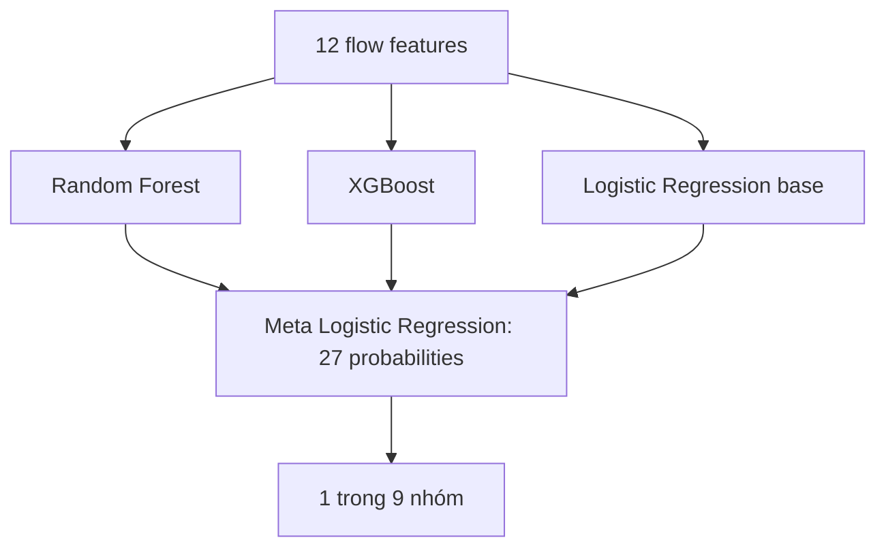

# Đối chiếu Stacking với code và rà soát triển khai

Ngày rà soát: 10/11/2026. Phạm vi sâu: đọc/sampling/mapping/split → baseline tuning → OOF/meta-search → refit/evaluate → model artifact → PCAP/live → gán nhãn/chấm lab và đóng gói VM. Giả định một sensor trong lab sinh viên, không phải IDS vận hành tốc độ cao. Các module EDA, host/Gaussian/graph/beaconing được xem như nhánh hỗ trợ, không phải các tầng của Stacking.

**Kết luận:** phần huấn luyện đang thực hiện Stacking hai tầng đúng cách dùng `StackingClassifier`, không phải voting hay nối hai model của hai dataset. Không phát hiện lỗi chặn train/load trong luồng đã kiểm thử. Đã sửa gói VM và quy tắc nhãn lab; độ chính xác realtime, parity với dataset và ưu thế ES trên cả hai nguồn vẫn chưa được xác nhận.

## 1. Vị trí tương ứng với mô tả của bạn

Số dòng dưới đây ứng với bản code khi lập báo cáo; dùng tên hàm/biểu thức để tra cứu nếu file đổi dòng.

| Nội dung | Chỗ tương ứng | Nhận xét |
|---|---|---|
| Hợp đồng feature | [features.py](../src/features.py), `FEATURES`; [dataset.py](../src/dataset.py):29, `numeric_features` | Chỉ lấy 12 đặc trưng chung. Label, RawLabel và source_dataset không là đầu vào |
| Tiền xử lý | [train.py](../src/train.py):45, `pipeline` | Median imputation trong pipeline từng base; StandardScaler cho LR. Pipeline được fit lại trong từng fold |
| Lựa chọn feature | [features.py](../src/features.py) | Bộ feature chọn thủ công để chung schema/train/deploy; chưa phải thuật toán feature selection tự động hoặc chứng minh bộ 12 feature tối ưu |
| Các baseline | [train.py](../src/train.py):30, `estimators` | DT, RF, XGB, LGBM, LR; SVM/KNN/NN trong mô tả chỉ là ví dụ, không bắt buộc có hết |
| Chia train/validation/test | [three_models.py](../src/three_models.py):20, `prepare_splits`; [train.py](../src/train.py):85, `split_data` | Khử vector trùng trước split; M1/M2/M3 dùng chung test của từng nguồn. Split ngẫu nhiên chưa tách các phiên liên quan |
| Chọn tham số baseline | [train.py](../src/train.py):174, `GridSearchCV` | CV trên train, scoring f1_macro; test không chọn tham số |
| Tạo OOF | [train.py](../src/train.py):194, `cross_val_predict(..., method='predict_proba')` | Mỗi hàng train nhận dự đoán từ model được fit trên các fold khác. Cache này phục vụ nhánh `--stack-search` |
| Tầng base | [train.py](../src/train.py):197, `trees` / `diverse` | Hai candidate: RF+XGB+LGBM hoặc RF+XGB+LR; DT chỉ làm baseline ở phiên bản hiện tại |
| Tầng meta | [train.py](../src/train.py):201, `LogisticRegression`; :202, `StackingClassifier` | LR là classifier tổng hợp; `passthrough=False`, `stack_method='predict_proba'` |
| Ghép đầu ra base | [train.py](../src/train.py):209, `np.hstack` | Ghép xác suất OOF. Nhị phân bỏ cột xác suất đầu mỗi base để khớp sklearn; đa lớp giữ các cột |
| Huấn luyện/chọn meta | [train.py](../src/train.py):211, `meta.fit`; :222, `winner` | Meta fit trên OOF train, chọn candidate bằng validation Macro-F1 |
| Huấn luyện bản cuối | [train.py](../src/train.py):230, `candidate.fit(x_dev, y_dev)` | Fit lại train+validation. StackingClassifier tự tạo OOF mới trên development để học meta, đồng thời fit base trên toàn development |
| Đánh giá | [train.py](../src/train.py):52, `evaluate` | Accuracy, Macro/Weighted-F1, Precision/Recall/F1 từng lớp, confusion matrix, FPR/FNR và binary attack metrics |
| Lưu model | [train.py](../src/train.py):247, `joblib.dump` | Artifact chứa model đầy đủ, 12 feature, thứ tự classes, task, taxonomy/version/hash và Python version |
| Suy luận | [detect.py](../src/detect.py):35, `predict_proba`; :50, ghi JSONL | Base đã fit tạo xác suất cho flow mới → meta trả xác suất cuối → chọn nhãn. Không huấn luyện lại khi bắt gói |

Trong mô tả, level-0 là base và level-1 là meta; cách gọi Tầng 1/Tầng 2 cũng hợp lệ. **M1/M2/M3 là ba cấu hình nguồn dữ liệu**, không phải ba tầng của Stacking. Mỗi cấu hình đều huấn luyện một Stacking riêng. M3 học từ hợp dữ liệu train hai nguồn sau mapping, không lấy hai artifact M1/M2 làm base.

## 2. Model M3 thực tế đã lưu

Đã nạp artifact `experiments/completion-20261110/multiclass-families-seed42/M3/models/stacking_ids.joblib` và kiểm tra đối tượng thật:

- Model: `StackingClassifier`, base **RF + XGB + LR**, meta **LogisticRegression**, CV 3 folds, `passthrough=False`.
- Có 9 lớp: BENIGN, BOT, BRUTE_FORCE, DDOS, DOS, INFILTRATION, RECON, U2R, WEB_ATTACK.
- Với 5 flow đầu test, `model.transform(X)` có shape **(5, 27)**: 3 base × 9 xác suất/lớp; meta có `n_features_in_=27`, `coef_.shape=(9, 27)`.
- Meta nhận 27 xác suất, không nhận 12 feature gốc. LR ở tầng base và LR ở tầng meta là hai model khác nhau với hai loại đầu vào khác nhau.
- Ở nhánh nhị phân với 3 base, sklearn giữ một cột xác suất mỗi base, nên meta có 3 cột; không áp dụng con số 27 cho mọi model.

Sơ đồ là luồng suy luận. Trong huấn luyện, đầu vào meta là xác suất **OOF**: không dùng dự đoán in-sample của base trên chính các hàng mà base vừa học. Khi suy luận, base fit trên toàn development tạo xác suất cho mẫu mới; không chạy K-fold trên traffic mới.

## 3. Những câu nên chỉnh trong phần lý thuyết

| Câu/ý trong bản gửi | Cách diễn đạt đúng hơn |
|---|---|
| Base model phải khác loại nhau | Thường dùng model đa dạng; cùng thuật toán với cấu hình khác vẫn có thể tạo stacking. Bản hiện tại dùng các thuật toán khác nhau |
| Đầu vào meta không phải dữ liệu gốc | Đúng với bản này do `passthrough=False`; không là luật bắt buộc của mọi Stacking vì sklearn hỗ trợ passthrough |
| Meta luôn nhận OOF | Đúng ở lúc học meta; lúc dự đoán, meta nhận đầu ra base fit trên toàn development |
| Meta có thể dùng Linear Regression | Với NIDS phân loại, dùng classifier như LogisticRegression/MLPClassifier. Không thay trực tiếp bằng LinearRegression hồi quy rồi coi là tương đương nếu chưa thiết kế quy tắc quyết định |
| Stacking có độ chính xác cao hơn model đơn và FPR thấp hơn | Đây là mục tiêu/khả năng, không bảo đảm. Phải so đúng test, taxonomy, ngân sách và báo số đo thật |
| Tổng quát tốt với tấn công biến đổi | Cần kiểm định trên các phiên/miền/tấn công được giữ riêng. Model hiện bắt buộc chọn một trong các nhãn đã biết, chưa có bằng chứng zero-day hoặc open-set detection |
| K-fold tránh overfitting | OOF giảm rủi ro meta học dự đoán in-sample; không loại bỏ mọi overfitting, domain shift hoặc lỗi chia dữ liệu |
| Cần thêm XAI/Zero Trust để đúng Stacking | Không phải điều kiện định nghĩa Stacking. Có thể bổ sung nếu yêu cầu đề tài, không cần thêm thư viện chỉ để hợp thức hóa kiến trúc hiện tại |

Nguồn chính: [StackingClassifier — scikit-learn](https://scikit-learn.org/stable/modules/generated/sklearn.ensemble.StackingClassifier.html) mô tả base fit full X, meta học bằng cross_val_predict và passthrough. [Shafieian & Zulkernine, Multi-layer stacking ensemble learners for low footprint network intrusion detection](https://doi.org/10.1007/s40747-022-00809-3) khảo sát cả two-layer và multi-layer trên bài toán riêng; số đo của bài đó không là bảo đảm cho CIC/InSDN hoặc kiến trúc này. Các trang tổng hợp trong bản gửi không thay cho nguồn phương pháp chính.

## 4. Các lỗi triển khai đã khắc phục

1. **Gói VM chưa có M3 đa lớp kết hợp.** Hướng dẫn cũ dẫn đến model nhị phân; không thể demo 9 nhóm bằng artifact đó. Đã thêm [package_vm.py](../src/package_vm.py), xuất ZIP riêng với model/pin/runtime/taxonomy/test và SHA256SUMS, đồng thời cập nhật [VM_DEPLOYMENT.md](VM_DEPLOYMENT.md). Nếu tiếp tục dùng ZIP cũ, kết quả vẫn là bài toán cũ.
2. **PortScan và RECON bị chấm là hai lớp khác nhau.** [evaluate_lab.py](../src/evaluate_lab.py) nay có `--model` để kiểm tra nhãn, `--truth-source cicids2017` để ánh xạ nhãn nguồn đã biết và `--binary-only` cho kịch bản ngoài taxonomy. Gán nhãn lab theo kịch bản độc lập, không theo prediction. Nếu không thống nhất taxonomy, kết quả phân loại chi tiết có thể sai dù phát hiện attack đúng.
3. **Parity chưa có đường dùng full CSV reference và provenance rõ ràng.** [feature_parity.py](../src/feature_parity.py) nay chuẩn hóa full CICFlowMeter CSV, yêu cầu timezone/format rõ, ghi checksum CSV/PCAP và cấu hình reference; từ chối cùng một file hai phía. [FEATURE_PARITY.md](FEATURE_PARITY.md) quy định cách thực hiện và xử lý fail. Chưa có capture/reference thật nên chưa công bố parity pass.
4. **File metrics lab có thể ghi đè lượt trước.** Đã đổi sang tạo độc quyền bằng mode `x`; output đã tồn tại bị từ chối. Không trộn hay mất kết quả các lượt khi chạy lại lệnh.

## 5. Các giới hạn còn lại, theo mức ảnh hưởng

### Cần giải quyết trước khi kết luận IDS live chính xác

5. **Chưa đo extractor parity và metrics trên Linux thật.** Detector Scapy có cách đóng flow/định hướng/đếm feature riêng; replay cùng extractor chỉ kiểm tra đường chạy. Cần chạy quy trình parity độc lập và lab có ground truth, FPR/FNR, độ trễ cả thời gian chờ flow, flow thiếu/drops. Nếu bỏ qua, không được suy ra độ chính xác realtime từ điểm offline. Hiện chỉ đủ triển khai kiểm thử PoC.

### Cần hoàn thiện để kết luận nghiên cứu mạnh hơn

6. **ES chưa vượt baseline trên cả hai nguồn.** Ba seed M3 cho mean Macro-F1: CIC 96,473% (XGB 96,361%), InSDN 93,480% (RF 95,055%), gộp 94,409% (RF 94,467%). Cải tiến bằng train/validation và xác nhận trên holdout mới; không chọn seed hoặc gom nhãn theo test để tạo kết luận thắng. Nếu dừng ở đây, báo cáo đúng là kết quả chưa đạt toàn bộ mục tiêu hiệu năng.
7. **OOF chưa phải nested tuning và split chưa tách phiên.** Siêu tham số base được chọn bằng CV trên toàn train trước khi tạo OOF. Các fit base/preprocessing trong từng OOF fold không dùng hàng held-out, nhưng bước chọn siêu tham số đã tham khảo các nhãn của toàn train; không gọi OOF là độc lập tuyệt đối ở mọi bước. Đây là giới hạn đã ghi trong protocol, không phải test bị đưa vào training. Nếu cần nghiên cứu chặt hơn, đặt tìm tham số bên trong từng outer fold và có holdout theo phiên/thời gian; cần metadata/thiết kế dữ liệu tương ứng. Nếu chưa làm, giữ rõ giới hạn khi diễn giải kết quả.

Phân tích hồi cứu M3/test InSDN, mean F1 từng lớp qua ba seed:

| Nhãn | RF | Stacking |
|---|---:|---:|
| BENIGN | 99,749% | 99,750% |
| BRUTE_FORCE | 85,979% | 85,837% |
| DDOS | 99,156% | 98,745% |
| DOS | 99,330% | 99,916% |
| RECON | 97,543% | 97,588% |
| U2R | 88,571% | 79,048% |

Phần lớn khoảng cách Macro-F1 với RF đến từ U2R: chỉ 3 hàng test mỗi seed nên vài lỗi đã thay đổi mạnh chỉ số. Đây là chẩn đoán trên test đã xem, không phải căn cứ tiếp tục lựa chọn tham số bằng test đó. Bước cải thiện có thể kiểm chứng là bổ sung dữ liệu/phiên hiếm có nhãn, chọn class weighting/candidate bằng train-validation và xác nhận trên holdout mới; tăng cap không tự tạo thêm mẫu U2R độc lập.

Các lớp hiếm (test seed 42 có U2R 3, INFILTRATION 7 mẫu), class cap và lớp chỉ có một nguồn cũng giới hạn khả năng suy rộng. Không có bằng chứng topology botnet hoặc C2 chỉ từ nhãn BOT; graph/beaconing đang là phân tích riêng.

## 6. Kiểm tra thực hiện

- 58 unit/integration test đã qua. Test mới kiểm tra ánh xạ lab, từ chối nguồn/nhãn sai, chế độ nhị phân, không ghi đè metrics, timezone/độ chính xác timestamp và parity fail. Test meta-search xác nhận cả nhị phân/đa lớp đều không passthrough và đúng số cột meta.
- Hai smoke test của M3 9 nhóm khớp 100%; điểm này chỉ là tái lập prediction.
- Gói ZIP mới được kiểm tra checksum, giải nén vào thư mục tách biệt, nạp model và chấm lại hai test bằng các file runtime trong ZIP. Cả Accuracy, Macro/Weighted-F1, FPR và FNR đều khớp reference của hai nguồn. Đã chạy replay PCAP tổng hợp qua detect → extract → evaluate bằng runtime giải nén, ghép đúng 1 flow; đây chỉ là self-check đường chạy, không tính thành kết quả lab thật.
- Không tự huấn luyện lại để đổi điểm test; `passthrough=False` được ghi tường minh, giữ nguyên hành vi model đã lưu.

**Phán quyết:** có thể bắt đầu kiểm thử VM bằng gói mới. Kiến trúc Stacking đúng; chưa hoàn thành kiểm chứng realtime hoặc mục tiêu ES tốt hơn baseline trên cả hai nguồn.

**Chưa kiểm tra được:** VM Linux thật, PCAP thật qua hai extractor độc lập, lưu lượng tải cao và holdout mới theo phiên/thời gian. Các nhánh host/Gaussian/graph/beaconing không được benchmark lại trong lượt rà soát core này.

## Cập nhật sau khi có CSV lab

Đã có bằng chứng Linux chạy từ người dùng, đồng thời phát hiện sai khác flag có nguồn xác nhận và FPR=100% trên 10 phiên HTTP BENIGN. Xem [LIVE_DIAGNOSIS.md](LIVE_DIAGNOSIS.md). Kiến trúc Stacking vẫn đúng; readiness cho phát hiện ngoài lab không được suy ra từ các test đóng gói.
